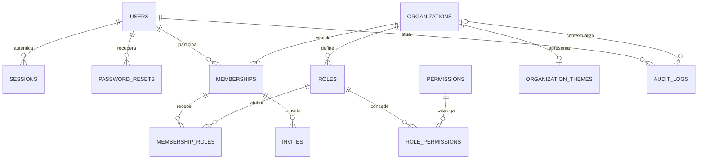
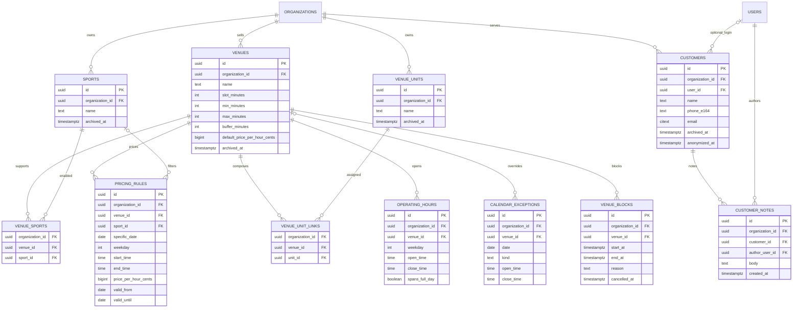
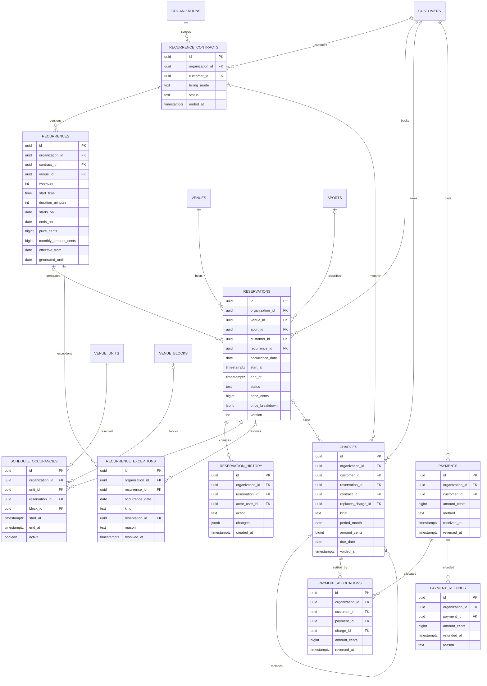

# ERD candidato do MVP — para aprovação do fundador

**Estado:** identidade implementada; domínios comerciais planejados. Fonte de requisitos: `ARENAHUB_MASTER_V3.2.md` §§4–7. Decisão estratégica: [ADR-009](decisions/ADR-009-founder-led-development.md). Premissas comerciais não foram validadas por entrevistas.

`organization_id` está indicado nas entidades tenant, mesmo quando omitido dos relacionamentos visuais para legibilidade. FKs entre entidades tenant devem incluir `organization_id`; os diagramas não substituem o contrato de constraints em [DATABASE.md](DATABASE.md). `users` é global; `memberships` associa a pessoa às arenas. `arena_jobs` é schema administrado por pg-boss e omitido.

## Identidade e acesso implementados em arena_identity

A chave da membership é (organization_id, user_id). is_owner é um atributo protegido. As duas pontas das atribuições compartilham organization_id. Cada organização operacional é provisionada com um Owner ativo. Instâncias de cargo têm nome único por organização, sem distinguir caixa.

Os diagramas seguintes são planejamento das fases 3 a 5. Pix acrescentará conta vinculada, intenção, tentativa, evento, reembolso e conciliação por organização. A reserva referencia uma versão da política central de cancelamento.

## Configuração da arena e clientes

### Questões estruturais deste grupo

- Venue comercializável permanece separado de unidade física; confirmar que espaço divisível pertence ao MVP mesmo que a UI simples oculte unidade única.
- `venue_id NULL` em exceção significa data fechada/especial para a arena inteira; unicidade exige `NULLS NOT DISTINCT` ou índices parciais.
- Definir se `operating_hours` representa cada turno como linha e como horários que atravessam meia-noite são representados sem ambiguidade.
- Regras de preço precisam escopo/nível normalizado, intervalos locais e vigência; escrita trava o venue e revalida após lock. Confirmar defaults antes de apresentar como regra padrão.
- Telefones duplicados não são proibidos; dados pessoais de notas devem ser mínimos e sujeitos a controle/retenção.

## Agenda, recorrência e financeiro

### Questões estruturais deste grupo

- Contrato de mensalista é estável; versões não podem sobrepor vigência. Ocorrências, exceções e reservas devem ser criadas/resolvidas em transações idempotentes.
- `schedule_occupancies` exige uma única origem (reserva ou bloqueio), range `[start,end)`, e exclusion constraint por unidade física. Reserva, bloqueio, mudança de unidades e preços compartilham locking de venue.
- Cobranças anuladas permanecem; índice parcial garante só uma ativa por reserva/tipo e contrato/mês. O job mensal também consulta cobranças anuladas para não recriá-las silenciosamente.
- Alocações ligam payment e charge do mesmo cliente e organização por FKs triplas; travar ambos antes de validar saldo. `charge_balances` e `payment_balances` são views candidatas com agregações separadas.
- Preservar snapshots de preço, competência e autoria em eventos financeiros; valores em inteiro/centavos.

## Fora do modelo de domínio

- Tabelas internas de `pg-boss` são geridas pela dependência no schema configurado e não fazem parte das migrations de domínio Prisma.
- `outbox_events`, página pública e login de cliente final ficam fora do MVP.
- O diagrama não é DDL nem autorização para construir: leia [DATABASE.md](DATABASE.md) para regras de integridade e aprovação do fundador.
